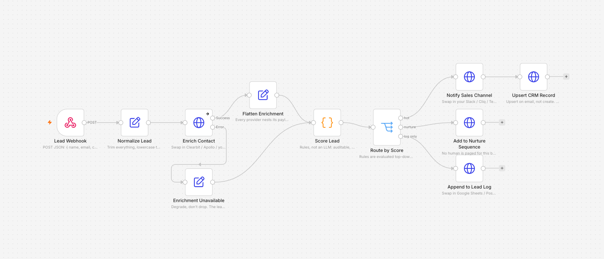

# Lead Capture → Enrich → Score → Route

The inbound-lead pipeline, written as a generic pattern: accept a form submission, clean it up, try to enrich it, score it with rules you can defend, and route it to the treatment it deserves.

**File:** [`workflows/lead-capture-enrich-score-route.json`](../workflows/lead-capture-enrich-score-route.json)
**Trigger:** Webhook (`POST /webhook/lead-capture`)



## Node-by-node

### 1. Lead Webhook

`POST` on path `lead-capture`, `responseMode: onReceived`.

The response is sent the moment the payload lands, before enrichment runs. A contact form should not sit spinning while a third-party API decides whether it feels like answering today. If you need the score returned synchronously instead, switch `responseMode` to `responseNode` and add a Respond to Webhook node at the end — but then the form's latency is the enrichment vendor's latency, which is a trade you should make deliberately.

### 2. Normalize Lead

A Set node that does the boring work once, so nothing downstream has to repeat it:

- trims every string field
- lowercases the email
- splits `name` into `first_name` / `last_name` on the first whitespace run
- extracts `email_domain` as its own field
- stamps `received_at` from `$now`

Pulling the domain out here matters more than it looks: both the scoring rules and the enrichment call need it, and computing it twice is how the two quietly disagree.

### 3. Enrich Contact

An HTTP Request node against a placeholder enrichment API, with `onError: continueErrorOutput`.

That setting is the important part. It gives the node a second output that fires on failure, so a dead vendor routes the lead down a fallback path instead of failing the execution. **A lead is a thing someone typed their name into. Losing one because a vendor returned a 503 is not an acceptable failure mode.**

Timeout is 8 seconds. An enrichment call that hasn't answered in 8 seconds isn't going to.

### 4a. Flatten Enrichment (success path)

Every enrichment provider nests its payload differently — `employees`, `company.metrics.employees`, `data.attributes.headcount`. This Set node collapses whatever came back into flat `enriched`, `company_size`, `industry` fields, so the scoring code reads one shape regardless of vendor. Swapping providers becomes a change to this node, not to the scoring rules.

### 4b. Enrichment Unavailable (error path)

Sets `enriched: false` and records `enrichment_error`, keeping all original fields via `includeOtherFields: true`. The lead continues to scoring and simply misses the enrichment points.

Both branches connect into the same input on **Score Lead**. n8n allows several nodes to feed one input, and unlike a Merge node it doesn't wait for both — whichever branch fired continues immediately.

### 5. Score Lead

A Code node producing a 0–100 score. Every rule is in the source with its point value in a comment:

| Signal | Points | Why |
|---|---|---|
| Business email domain | +40 | The strongest cheap signal that this is a real buyer |
| Freemail domain (gmail, yahoo, …) | +10 | Still a lead, just a weaker one |
| Role address (`info@`, `sales@`) | −10 | No named human owns the conversation yet |
| Company name provided | +15 | Effort, and something to match on in the CRM |
| Message ≥ 300 chars | +25 | Long messages mean a problem someone wants solved |
| Message ≥ 80 chars | +15 | |
| Message present but short | +5 | |
| Enrichment matched | +10 | |
| Enriched company size ≥ 50 | +10 | |

The score is clamped to 0–100 and a `band` field (`hot` / `nurture` / `log`) is derived from the same thresholds the Switch uses.

The node also emits `score_reasons`, an array of human-readable strings like `"business email domain (+40)"`. When sales asks why a lead didn't reach them, the answer is already attached to the record.

### 6. Route by Score

A Switch node with two rules and a fallback:

| Output | Condition | Treatment |
|---|---|---|
| `hot` | score ≥ 70 | Real-time notification + CRM upsert |
| `nurture` | score ≥ 40 | Drip sequence, no human paged |
| `log only` | fallback | Recorded for reporting |

Rules evaluate top-down, so the `≥ 40` rule only ever sees leads that already failed `≥ 70`. That's why the second rule isn't written as a range.

### 7. The three branches

- **Hot** → `Notify Sales Channel` (chat webhook) → `Upsert CRM Record`. Chained, not parallel: if the CRM write fails you still want to know the notification went out, and the execution log shows exactly where it stopped.
- **Nurture** → `Add to Nurture Sequence`.
- **Log only** → `Append to Lead Log`.

The CRM node **upserts on email rather than creating**. Someone submitting the same form twice should update one record, not open two.

Low-scoring leads are still written to the log. You cannot tune a scoring rule you never measured, and the only way to learn that your `≥ 70` threshold is wrong is to have the sub-40 pile sitting there to check against closed deals.

## JSON contract

**In** (`POST /webhook/lead-capture`):

```json
{
  "name": "Dana Whitfield",
  "email": "dana@acme-industrial.com",
  "company": "Acme Industrial",
  "message": "We're replacing our phone system across four sites and need help scoping it."
}
```

**Out** (immediate webhook response):

```json
{ "received": true }
```

**Internal shape after scoring** (what the branches consume):

```json
{
  "first_name": "Dana",
  "last_name": "Whitfield",
  "email": "dana@acme-industrial.com",
  "email_domain": "acme-industrial.com",
  "company": "Acme Industrial",
  "message": "We're replacing our phone system…",
  "received_at": "2026-08-14T17:30:00.000-07:00",
  "enriched": true,
  "company_size": 240,
  "industry": "Manufacturing",
  "score": 85,
  "band": "hot",
  "score_reasons": [
    "business email domain (+40)",
    "company provided (+15)",
    "substantive message, 80+ chars (+15)",
    "enrichment matched (+10)",
    "company size 240 (+10)"
  ]
}
```

## What to swap for production

| Node | Replace | With |
|---|---|---|
| Enrich Contact | `https://enrichment.example.com/v1/enrich` | Clearbit, Apollo, or your provider — plus a credential on the node |
| Flatten Enrichment | Field paths | Whatever your provider actually nests |
| Notify Sales Channel | `https://chat.example.com/...` | Your Slack / Cliq / Teams incoming webhook |
| Upsert CRM Record | `https://crm.example.com/...` | Your CRM's upsert endpoint |
| Add to Nurture Sequence | `https://marketing.example.com/...` | Your ESP |
| Append to Lead Log | `https://warehouse.example.com/...` | Google Sheets, Postgres, or your warehouse |

Also set an **error workflow** in workflow settings (`settings.errorWorkflow`, left empty here). Without one, a failure that isn't caught by the enrichment error branch is visible only to whoever opens the executions list.

## Extension ideas

The most valuable addition is a feedback loop: once leads have outcomes in the CRM, join closed-won records back against `score_reasons` and check whether the point values you invented actually predict anything. Most hand-written scoring models have one rule doing all the work and three that are noise, and you can only find out by measuring. Beyond that — dedupe against existing CRM contacts before scoring so returning customers skip the sales notification entirely; add a disposable-domain check to the email rules; and if enrichment failures become common, queue the failed leads for a retry pass rather than accepting the lower score permanently.
